<!-- Generated by tools/build_profile.py from profile.json and the Gitty ledger. Edit those, not this file. -->
<picture><source media="(max-width: 600px) and (prefers-color-scheme: dark)" srcset="https://raw.githubusercontent.com/tausif-ahmed-guardian/tausif-ahmed-guardian/main/assets/dark/hero-m.813a2e33.svg"><source media="(max-width: 600px)" srcset="https://raw.githubusercontent.com/tausif-ahmed-guardian/tausif-ahmed-guardian/main/assets/light/hero-m.c94096ae.svg"><source media="(prefers-color-scheme: dark)" srcset="https://raw.githubusercontent.com/tausif-ahmed-guardian/tausif-ahmed-guardian/main/assets/dark/hero.d813cfea.svg"></picture>

<a href="https://www.linkedin.com/in/tausif-ahmed-b5b8962a/"><picture><source media="(prefers-color-scheme: dark)" srcset="https://raw.githubusercontent.com/tausif-ahmed-guardian/tausif-ahmed-guardian/main/assets/dark/pill-linkedin.4ae45847.svg"></picture></a> <a href="https://purplecop.com"><picture><source media="(prefers-color-scheme: dark)" srcset="https://raw.githubusercontent.com/tausif-ahmed-guardian/tausif-ahmed-guardian/main/assets/dark/pill-purplecop.46a630bd.svg"></picture></a>

<picture><source media="(max-width: 600px) and (prefers-color-scheme: dark)" srcset="https://raw.githubusercontent.com/tausif-ahmed-guardian/tausif-ahmed-guardian/main/assets/dark/ticker-m.b5884948.svg"><source media="(max-width: 600px)" srcset="https://raw.githubusercontent.com/tausif-ahmed-guardian/tausif-ahmed-guardian/main/assets/light/ticker-m.3de6ca92.svg"><source media="(prefers-color-scheme: dark)" srcset="https://raw.githubusercontent.com/tausif-ahmed-guardian/tausif-ahmed-guardian/main/assets/dark/ticker.b595330c.svg"></picture>

<picture><source media="(max-width: 600px) and (prefers-color-scheme: dark)" srcset="https://raw.githubusercontent.com/tausif-ahmed-guardian/tausif-ahmed-guardian/main/assets/dark/intro-m.62a06fdb.svg"><source media="(max-width: 600px)" srcset="https://raw.githubusercontent.com/tausif-ahmed-guardian/tausif-ahmed-guardian/main/assets/light/intro-m.6a06fcc4.svg"><source media="(prefers-color-scheme: dark)" srcset="https://raw.githubusercontent.com/tausif-ahmed-guardian/tausif-ahmed-guardian/main/assets/dark/intro.38208d6a.svg"></picture>

<picture><source media="(max-width: 600px) and (prefers-color-scheme: dark)" srcset="https://raw.githubusercontent.com/tausif-ahmed-guardian/tausif-ahmed-guardian/main/assets/dark/sec-upstream-m.6481c0d6.svg"><source media="(max-width: 600px)" srcset="https://raw.githubusercontent.com/tausif-ahmed-guardian/tausif-ahmed-guardian/main/assets/light/sec-upstream-m.bee3925f.svg"><source media="(prefers-color-scheme: dark)" srcset="https://raw.githubusercontent.com/tausif-ahmed-guardian/tausif-ahmed-guardian/main/assets/dark/sec-upstream.5758bcec.svg"></picture>

<picture><source media="(max-width: 600px) and (prefers-color-scheme: dark)" srcset="https://raw.githubusercontent.com/tausif-ahmed-guardian/tausif-ahmed-guardian/main/assets/dark/chart-m.1ee450bf.svg"><source media="(max-width: 600px)" srcset="https://raw.githubusercontent.com/tausif-ahmed-guardian/tausif-ahmed-guardian/main/assets/light/chart-m.5542392b.svg"><source media="(prefers-color-scheme: dark)" srcset="https://raw.githubusercontent.com/tausif-ahmed-guardian/tausif-ahmed-guardian/main/assets/dark/chart.5ddebcf8.svg"></picture>

<picture><source media="(max-width: 600px) and (prefers-color-scheme: dark)" srcset="https://raw.githubusercontent.com/tausif-ahmed-guardian/tausif-ahmed-guardian/main/assets/dark/sub-merged-m.ef3b4a17.svg"><source media="(max-width: 600px)" srcset="https://raw.githubusercontent.com/tausif-ahmed-guardian/tausif-ahmed-guardian/main/assets/light/sub-merged-m.df688b6d.svg"><source media="(prefers-color-scheme: dark)" srcset="https://raw.githubusercontent.com/tausif-ahmed-guardian/tausif-ahmed-guardian/main/assets/dark/sub-merged.2682bc58.svg"></picture>
<picture><source media="(max-width: 600px) and (prefers-color-scheme: dark)" srcset="https://raw.githubusercontent.com/tausif-ahmed-guardian/tausif-ahmed-guardian/main/assets/dark/empty-merged-m.e0bdbfe7.svg"><source media="(max-width: 600px)" srcset="https://raw.githubusercontent.com/tausif-ahmed-guardian/tausif-ahmed-guardian/main/assets/light/empty-merged-m.f006d24d.svg"><source media="(prefers-color-scheme: dark)" srcset="https://raw.githubusercontent.com/tausif-ahmed-guardian/tausif-ahmed-guardian/main/assets/dark/empty-merged.8447b1de.svg"></picture>

<picture><source media="(max-width: 600px) and (prefers-color-scheme: dark)" srcset="https://raw.githubusercontent.com/tausif-ahmed-guardian/tausif-ahmed-guardian/main/assets/dark/sub-review-m.c08dc4bf.svg"><source media="(max-width: 600px)" srcset="https://raw.githubusercontent.com/tausif-ahmed-guardian/tausif-ahmed-guardian/main/assets/light/sub-review-m.cad67a9e.svg"><source media="(prefers-color-scheme: dark)" srcset="https://raw.githubusercontent.com/tausif-ahmed-guardian/tausif-ahmed-guardian/main/assets/dark/sub-review.74818dec.svg"></picture>
<a href="https://github.com/NVIDIA/garak/issues/2466"><picture><source media="(max-width: 600px) and (prefers-color-scheme: dark)" srcset="https://raw.githubusercontent.com/tausif-ahmed-guardian/tausif-ahmed-guardian/main/assets/dark/row-garak-2466-m.72b72248.svg"><source media="(max-width: 600px)" srcset="https://raw.githubusercontent.com/tausif-ahmed-guardian/tausif-ahmed-guardian/main/assets/light/row-garak-2466-m.16009e00.svg"><source media="(prefers-color-scheme: dark)" srcset="https://raw.githubusercontent.com/tausif-ahmed-guardian/tausif-ahmed-guardian/main/assets/dark/row-garak-2466.dfeab63b.svg"></picture></a>
<a href="https://github.com/ruvnet/QuDAG/issues/44"><picture><source media="(max-width: 600px) and (prefers-color-scheme: dark)" srcset="https://raw.githubusercontent.com/tausif-ahmed-guardian/tausif-ahmed-guardian/main/assets/dark/row-qudag-44-m.f9104d3d.svg"><source media="(max-width: 600px)" srcset="https://raw.githubusercontent.com/tausif-ahmed-guardian/tausif-ahmed-guardian/main/assets/light/row-qudag-44-m.0577ec6e.svg"><source media="(prefers-color-scheme: dark)" srcset="https://raw.githubusercontent.com/tausif-ahmed-guardian/tausif-ahmed-guardian/main/assets/dark/row-qudag-44.05d9aebd.svg"></picture></a>
<a href="https://github.com/OrchIntel/ioa-core/issues/2"><picture><source media="(max-width: 600px) and (prefers-color-scheme: dark)" srcset="https://raw.githubusercontent.com/tausif-ahmed-guardian/tausif-ahmed-guardian/main/assets/dark/row-ioa-core-2-m.56400ffd.svg"><source media="(max-width: 600px)" srcset="https://raw.githubusercontent.com/tausif-ahmed-guardian/tausif-ahmed-guardian/main/assets/light/row-ioa-core-2-m.4bc18fc1.svg"><source media="(prefers-color-scheme: dark)" srcset="https://raw.githubusercontent.com/tausif-ahmed-guardian/tausif-ahmed-guardian/main/assets/dark/row-ioa-core-2.9c3ce335.svg"></picture></a>

In review means submitted and not merged. [Every public issue and PR I have opened](https://github.com/search?q=author%3Atausif-ahmed-guardian&type=issues).

<picture><source media="(max-width: 600px) and (prefers-color-scheme: dark)" srcset="https://raw.githubusercontent.com/tausif-ahmed-guardian/tausif-ahmed-guardian/main/assets/dark/sec-focus-m.4b478d16.svg"><source media="(max-width: 600px)" srcset="https://raw.githubusercontent.com/tausif-ahmed-guardian/tausif-ahmed-guardian/main/assets/light/sec-focus-m.b2eac095.svg"><source media="(prefers-color-scheme: dark)" srcset="https://raw.githubusercontent.com/tausif-ahmed-guardian/tausif-ahmed-guardian/main/assets/dark/sec-focus.c69220d7.svg"></picture>

<picture><source media="(max-width: 600px) and (prefers-color-scheme: dark)" srcset="https://raw.githubusercontent.com/tausif-ahmed-guardian/tausif-ahmed-guardian/main/assets/dark/focus-m.7b9b2be4.svg"><source media="(max-width: 600px)" srcset="https://raw.githubusercontent.com/tausif-ahmed-guardian/tausif-ahmed-guardian/main/assets/light/focus-m.4f070d5a.svg"><source media="(prefers-color-scheme: dark)" srcset="https://raw.githubusercontent.com/tausif-ahmed-guardian/tausif-ahmed-guardian/main/assets/dark/focus.a8b79ff2.svg"></picture>

<picture><source media="(max-width: 600px) and (prefers-color-scheme: dark)" srcset="https://raw.githubusercontent.com/tausif-ahmed-guardian/tausif-ahmed-guardian/main/assets/dark/sec-bg-m.409d2416.svg"><source media="(max-width: 600px)" srcset="https://raw.githubusercontent.com/tausif-ahmed-guardian/tausif-ahmed-guardian/main/assets/light/sec-bg-m.a6da6266.svg"><source media="(prefers-color-scheme: dark)" srcset="https://raw.githubusercontent.com/tausif-ahmed-guardian/tausif-ahmed-guardian/main/assets/dark/sec-bg.87f5493e.svg"></picture>

<picture><source media="(max-width: 600px) and (prefers-color-scheme: dark)" srcset="https://raw.githubusercontent.com/tausif-ahmed-guardian/tausif-ahmed-guardian/main/assets/dark/background-m.25c5128d.svg"><source media="(max-width: 600px)" srcset="https://raw.githubusercontent.com/tausif-ahmed-guardian/tausif-ahmed-guardian/main/assets/light/background-m.9e76a135.svg"><source media="(prefers-color-scheme: dark)" srcset="https://raw.githubusercontent.com/tausif-ahmed-guardian/tausif-ahmed-guardian/main/assets/dark/background.58148f20.svg"></picture>

<picture><source media="(max-width: 600px) and (prefers-color-scheme: dark)" srcset="https://raw.githubusercontent.com/tausif-ahmed-guardian/tausif-ahmed-guardian/main/assets/dark/foot-m.ac91381e.svg"><source media="(max-width: 600px)" srcset="https://raw.githubusercontent.com/tausif-ahmed-guardian/tausif-ahmed-guardian/main/assets/light/foot-m.93079325.svg"><source media="(prefers-color-scheme: dark)" srcset="https://raw.githubusercontent.com/tausif-ahmed-guardian/tausif-ahmed-guardian/main/assets/dark/foot.56b0b5ec.svg"></picture>

<a href="https://www.linkedin.com/in/tausif-ahmed-b5b8962a/"><picture><source media="(prefers-color-scheme: dark)" srcset="https://raw.githubusercontent.com/tausif-ahmed-guardian/tausif-ahmed-guardian/main/assets/dark/pill-linkedin.4ae45847.svg"></picture></a> <a href="https://purplecop.com"><picture><source media="(prefers-color-scheme: dark)" srcset="https://raw.githubusercontent.com/tausif-ahmed-guardian/tausif-ahmed-guardian/main/assets/dark/pill-purplecop.46a630bd.svg"></picture></a>

