<!-- Generated by tools/build_profile.py from profile.json and GitHub search. Edit those, not this file. -->
<picture><source media="(max-width: 600px)" srcset="https://raw.githubusercontent.com/tausif-ahmed-guardian/tausif-ahmed-guardian/main/assets/dark/hero-m.ca633209.svg"></picture>

<a href="https://tausif-ahmed-guardian.github.io"><picture></picture></a> <a href="https://www.linkedin.com/in/tausif-ahmed-b5b8962a/"><picture></picture></a> <a href="https://purplecop.com"><picture></picture></a>

<picture><source media="(max-width: 600px)" srcset="https://raw.githubusercontent.com/tausif-ahmed-guardian/tausif-ahmed-guardian/main/assets/dark/ticker-m.00987d4c.svg"></picture>

<picture><source media="(max-width: 600px)" srcset="https://raw.githubusercontent.com/tausif-ahmed-guardian/tausif-ahmed-guardian/main/assets/dark/intro-m.62a06fdb.svg"></picture>

<picture><source media="(max-width: 600px)" srcset="https://raw.githubusercontent.com/tausif-ahmed-guardian/tausif-ahmed-guardian/main/assets/dark/sec-upstream-m.39329cd6.svg"></picture>

<picture><source media="(max-width: 600px)" srcset="https://raw.githubusercontent.com/tausif-ahmed-guardian/tausif-ahmed-guardian/main/assets/dark/chart-m.3b4623b4.svg"></picture>

<picture><source media="(max-width: 600px)" srcset="https://raw.githubusercontent.com/tausif-ahmed-guardian/tausif-ahmed-guardian/main/assets/dark/sub-merged-m.033fc175.svg"></picture>
<a href="https://github.com/OWASP/CheatSheetSeries/pull/3041"><picture><source media="(max-width: 600px)" srcset="https://raw.githubusercontent.com/tausif-ahmed-guardian/tausif-ahmed-guardian/main/assets/dark/row-cheatsheetseries-3041-m.8905a2b3.svg"></picture></a>
<a href="https://github.com/OWASP/wstg/pull/1755"><picture><source media="(max-width: 600px)" srcset="https://raw.githubusercontent.com/tausif-ahmed-guardian/tausif-ahmed-guardian/main/assets/dark/row-wstg-1755-m.3a798998.svg"></picture></a>
<a href="https://github.com/OWASP/ASVS/pull/3446"><picture><source media="(max-width: 600px)" srcset="https://raw.githubusercontent.com/tausif-ahmed-guardian/tausif-ahmed-guardian/main/assets/dark/row-asvs-3446-m.f353758c.svg"></picture></a>
<a href="https://github.com/slsa-framework/slsa/pull/1687"><picture><source media="(max-width: 600px)" srcset="https://raw.githubusercontent.com/tausif-ahmed-guardian/tausif-ahmed-guardian/main/assets/dark/row-slsa-1687-m.cdcd643c.svg"></picture></a>
<a href="https://github.com/ossf/wg-best-practices-os-developers/pull/1206"><picture><source media="(max-width: 600px)" srcset="https://raw.githubusercontent.com/tausif-ahmed-guardian/tausif-ahmed-guardian/main/assets/dark/row-wg-best-practices-os-developers-1206-m.18b5b7cd.svg"></picture></a>
<a href="https://github.com/GoogleCloudPlatform/k8s-aibom/pull/390"><picture><source media="(max-width: 600px)" srcset="https://raw.githubusercontent.com/tausif-ahmed-guardian/tausif-ahmed-guardian/main/assets/dark/row-k8s-aibom-390-m.1cd2e340.svg"></picture></a>
<a href="https://github.com/Nox-HQ/nox/pull/1092"><picture><source media="(max-width: 600px)" srcset="https://raw.githubusercontent.com/tausif-ahmed-guardian/tausif-ahmed-guardian/main/assets/dark/row-nox-1092-m.bb80188e.svg"></picture></a>
<a href="https://github.com/kubescape/regolibrary/pull/949"><picture><source media="(max-width: 600px)" srcset="https://raw.githubusercontent.com/tausif-ahmed-guardian/tausif-ahmed-guardian/main/assets/dark/row-regolibrary-949-m.d5bb2d76.svg"></picture></a>
<a href="https://github.com/Avarok-Cybersecurity/Citadel-Protocol/pull/375"><picture><source media="(max-width: 600px)" srcset="https://raw.githubusercontent.com/tausif-ahmed-guardian/tausif-ahmed-guardian/main/assets/dark/row-citadel-protocol-375-m.8a7f4a1f.svg"></picture></a>
<a href="https://github.com/OWASP/www-community/pull/1364"><picture><source media="(max-width: 600px)" srcset="https://raw.githubusercontent.com/tausif-ahmed-guardian/tausif-ahmed-guardian/main/assets/dark/row-www-community-1364-m.401c93b0.svg"></picture></a>
<a href="https://github.com/OWASP/www-community/pull/1363"><picture><source media="(max-width: 600px)" srcset="https://raw.githubusercontent.com/tausif-ahmed-guardian/tausif-ahmed-guardian/main/assets/dark/row-www-community-1363-m.e6cc5c3b.svg"></picture></a>
<a href="https://github.com/AGGIB/Stroq/pull/325"><picture><source media="(max-width: 600px)" srcset="https://raw.githubusercontent.com/tausif-ahmed-guardian/tausif-ahmed-guardian/main/assets/dark/row-stroq-325-m.1cfb4712.svg"></picture></a>
<a href="https://github.com/Tencent/AI-Infra-Guard/pull/764"><picture><source media="(max-width: 600px)" srcset="https://raw.githubusercontent.com/tausif-ahmed-guardian/tausif-ahmed-guardian/main/assets/dark/row-ai-infra-guard-764-m.bc201752.svg"></picture></a>
<a href="https://github.com/hashgraph-online/hol-guard/pull/7763"><picture><source media="(max-width: 600px)" srcset="https://raw.githubusercontent.com/tausif-ahmed-guardian/tausif-ahmed-guardian/main/assets/dark/row-hol-guard-7763-m.a14b35bd.svg"></picture></a>
<a href="https://github.com/solongate/agent-security/pull/395"><picture><source media="(max-width: 600px)" srcset="https://raw.githubusercontent.com/tausif-ahmed-guardian/tausif-ahmed-guardian/main/assets/dark/row-agent-security-395-m.3a5f3830.svg"></picture></a>
<a href="https://github.com/Agent-Threat-Rule/agent-threat-rules/pull/851"><picture><source media="(max-width: 600px)" srcset="https://raw.githubusercontent.com/tausif-ahmed-guardian/tausif-ahmed-guardian/main/assets/dark/row-agent-threat-rules-851-m.09b3f9bf.svg"></picture></a>
<a href="https://github.com/msoedov/agentic_security/pull/383"><picture><source media="(max-width: 600px)" srcset="https://raw.githubusercontent.com/tausif-ahmed-guardian/tausif-ahmed-guardian/main/assets/dark/row-agentic-security-383-m.27f5c67a.svg"></picture></a>
<a href="https://github.com/stacklok/toolhive/pull/7142"><picture><source media="(max-width: 600px)" srcset="https://raw.githubusercontent.com/tausif-ahmed-guardian/tausif-ahmed-guardian/main/assets/dark/row-toolhive-7142-m.5cdba997.svg"></picture></a>
<a href="https://github.com/ossf/python-secure-coding-guide/pull/31"><picture><source media="(max-width: 600px)" srcset="https://raw.githubusercontent.com/tausif-ahmed-guardian/tausif-ahmed-guardian/main/assets/dark/row-python-secure-coding-guide-31-m.dca5dfb1.svg"></picture></a>
<a href="https://github.com/GoogleCloudPlatform/k8s-aibom/pull/387"><picture><source media="(max-width: 600px)" srcset="https://raw.githubusercontent.com/tausif-ahmed-guardian/tausif-ahmed-guardian/main/assets/dark/row-k8s-aibom-387-m.2c1f07bc.svg"></picture></a>

<picture><source media="(max-width: 600px)" srcset="https://raw.githubusercontent.com/tausif-ahmed-guardian/tausif-ahmed-guardian/main/assets/dark/sub-review-m.c08dc4bf.svg"></picture>
<a href="https://github.com/OWASP/CheatSheetSeries/pull/3044"><picture><source media="(max-width: 600px)" srcset="https://raw.githubusercontent.com/tausif-ahmed-guardian/tausif-ahmed-guardian/main/assets/dark/row-cheatsheetseries-3044-m.3622cc5f.svg"></picture></a>
<a href="https://github.com/ossf/best-practices-badge/issues/3145"><picture><source media="(max-width: 600px)" srcset="https://raw.githubusercontent.com/tausif-ahmed-guardian/tausif-ahmed-guardian/main/assets/dark/row-best-practices-badge-3145-m.61696288.svg"></picture></a>
<a href="https://github.com/OWASP/CheatSheetSeries/pull/3043"><picture><source media="(max-width: 600px)" srcset="https://raw.githubusercontent.com/tausif-ahmed-guardian/tausif-ahmed-guardian/main/assets/dark/row-cheatsheetseries-3043-m.093b03af.svg"></picture></a>
<a href="https://github.com/kubernetes/website/pull/59249"><picture><source media="(max-width: 600px)" srcset="https://raw.githubusercontent.com/tausif-ahmed-guardian/tausif-ahmed-guardian/main/assets/dark/row-website-59249-m.18cc0714.svg"></picture></a>
<a href="https://github.com/OWASP/ASVS/issues/3449"><picture><source media="(max-width: 600px)" srcset="https://raw.githubusercontent.com/tausif-ahmed-guardian/tausif-ahmed-guardian/main/assets/dark/row-asvs-3449-m.1bcbdb85.svg"></picture></a>
<a href="https://github.com/google/skills/issues/263"><picture><source media="(max-width: 600px)" srcset="https://raw.githubusercontent.com/tausif-ahmed-guardian/tausif-ahmed-guardian/main/assets/dark/row-skills-263-m.c57ece1f.svg"></picture></a>
<a href="https://github.com/OWASP/Top10/issues/986"><picture><source media="(max-width: 600px)" srcset="https://raw.githubusercontent.com/tausif-ahmed-guardian/tausif-ahmed-guardian/main/assets/dark/row-top10-986-m.2d9811fd.svg"></picture></a>
<a href="https://github.com/CycloneDX/specification/issues/1249"><picture><source media="(max-width: 600px)" srcset="https://raw.githubusercontent.com/tausif-ahmed-guardian/tausif-ahmed-guardian/main/assets/dark/row-specification-1249-m.a3a0d506.svg"></picture></a>
<a href="https://github.com/cisagov/ScubaGoggles/pull/1275"><picture><source media="(max-width: 600px)" srcset="https://raw.githubusercontent.com/tausif-ahmed-guardian/tausif-ahmed-guardian/main/assets/dark/row-scubagoggles-1275-m.75b9c55d.svg"></picture></a>
<a href="https://github.com/cisagov/ScubaGoggles/pull/1274"><picture><source media="(max-width: 600px)" srcset="https://raw.githubusercontent.com/tausif-ahmed-guardian/tausif-ahmed-guardian/main/assets/dark/row-scubagoggles-1274-m.1a033c29.svg"></picture></a>
<a href="https://github.com/falcosecurity/falco-lsp/pull/30"><picture><source media="(max-width: 600px)" srcset="https://raw.githubusercontent.com/tausif-ahmed-guardian/tausif-ahmed-guardian/main/assets/dark/row-falco-lsp-30-m.afd2dc19.svg"></picture></a>
<a href="https://github.com/google/skills/issues/260"><picture><source media="(max-width: 600px)" srcset="https://raw.githubusercontent.com/tausif-ahmed-guardian/tausif-ahmed-guardian/main/assets/dark/row-skills-260-m.58cd0145.svg"></picture></a>
<a href="https://github.com/google/oss-fuzz/pull/16554"><picture><source media="(max-width: 600px)" srcset="https://raw.githubusercontent.com/tausif-ahmed-guardian/tausif-ahmed-guardian/main/assets/dark/row-oss-fuzz-16554-m.8cade176.svg"></picture></a>
<a href="https://github.com/cisco-ai-defense/skill-scanner/pull/307"><picture><source media="(max-width: 600px)" srcset="https://raw.githubusercontent.com/tausif-ahmed-guardian/tausif-ahmed-guardian/main/assets/dark/row-skill-scanner-307-m.3999647f.svg"></picture></a>
<a href="https://github.com/trailofbits/skills/pull/518"><picture><source media="(max-width: 600px)" srcset="https://raw.githubusercontent.com/tausif-ahmed-guardian/tausif-ahmed-guardian/main/assets/dark/row-skills-518-m.9543cc87.svg"></picture></a>
<a href="https://github.com/nasa/CryptoLib/issues/567"><picture><source media="(max-width: 600px)" srcset="https://raw.githubusercontent.com/tausif-ahmed-guardian/tausif-ahmed-guardian/main/assets/dark/row-cryptolib-567-m.1d3158a0.svg"></picture></a>
<a href="https://github.com/microsoft/agent-governance-toolkit/pull/4579"><picture><source media="(max-width: 600px)" srcset="https://raw.githubusercontent.com/tausif-ahmed-guardian/tausif-ahmed-guardian/main/assets/dark/row-agent-governance-toolkit-4579-m.a54f1c90.svg"></picture></a>
<a href="https://github.com/goauthentik/authentik/pull/27830"><picture><source media="(max-width: 600px)" srcset="https://raw.githubusercontent.com/tausif-ahmed-guardian/tausif-ahmed-guardian/main/assets/dark/row-authentik-27830-m.a15287bb.svg"></picture></a>
<a href="https://github.com/ai-sdlc-framework/ai-sdlc/pull/2683"><picture><source media="(max-width: 600px)" srcset="https://raw.githubusercontent.com/tausif-ahmed-guardian/tausif-ahmed-guardian/main/assets/dark/row-ai-sdlc-2683-m.b498220b.svg"></picture></a>
<a href="https://github.com/nasa/fprime/issues/6397"><picture><source media="(max-width: 600px)" srcset="https://raw.githubusercontent.com/tausif-ahmed-guardian/tausif-ahmed-guardian/main/assets/dark/row-fprime-6397-m.9eb1cf8e.svg"></picture></a>
<a href="https://github.com/alexgreensh/repo-forensics/pull/91"><picture><source media="(max-width: 600px)" srcset="https://raw.githubusercontent.com/tausif-ahmed-guardian/tausif-ahmed-guardian/main/assets/dark/row-repo-forensics-91-m.c5fdf8cb.svg"></picture></a>
<a href="https://github.com/step-security/dev-machine-guard/pull/303"><picture><source media="(max-width: 600px)" srcset="https://raw.githubusercontent.com/tausif-ahmed-guardian/tausif-ahmed-guardian/main/assets/dark/row-dev-machine-guard-303-m.3b1f8465.svg"></picture></a>
<a href="https://github.com/microsoft/component-detection/pull/1912"><picture><source media="(max-width: 600px)" srcset="https://raw.githubusercontent.com/tausif-ahmed-guardian/tausif-ahmed-guardian/main/assets/dark/row-component-detection-1912-m.59c47ba7.svg"></picture></a>
<a href="https://github.com/IBM/mcp-context-forge/issues/7544"><picture><source media="(max-width: 600px)" srcset="https://raw.githubusercontent.com/tausif-ahmed-guardian/tausif-ahmed-guardian/main/assets/dark/row-mcp-context-forge-7544-m.116d20a3.svg"></picture></a>
<a href="https://github.com/google/cybernetic-agent-governance-engine/pull/747"><picture><source media="(max-width: 600px)" srcset="https://raw.githubusercontent.com/tausif-ahmed-guardian/tausif-ahmed-guardian/main/assets/dark/row-cybernetic-agent-governance-engine-747-m.59240fb1.svg"></picture></a>
<a href="https://github.com/IBM/ai-security-baseline/pull/46"><picture><source media="(max-width: 600px)" srcset="https://raw.githubusercontent.com/tausif-ahmed-guardian/tausif-ahmed-guardian/main/assets/dark/row-ai-security-baseline-46-m.9d1273b0.svg"></picture></a>
<a href="https://github.com/NVIDIA/garak/issues/2466"><picture><source media="(max-width: 600px)" srcset="https://raw.githubusercontent.com/tausif-ahmed-guardian/tausif-ahmed-guardian/main/assets/dark/row-garak-2466-m.559b41b2.svg"></picture></a>
<a href="https://github.com/OrchIntel/ioa-core/issues/2"><picture><source media="(max-width: 600px)" srcset="https://raw.githubusercontent.com/tausif-ahmed-guardian/tausif-ahmed-guardian/main/assets/dark/row-ioa-core-2-m.3771b0bc.svg"></picture></a>
<a href="https://github.com/ruvnet/QuDAG/issues/44"><picture><source media="(max-width: 600px)" srcset="https://raw.githubusercontent.com/tausif-ahmed-guardian/tausif-ahmed-guardian/main/assets/dark/row-qudag-44-m.568e456a.svg"></picture></a>

In review means submitted and not merged. [Every public issue and PR I have opened](https://github.com/search?q=author%3Atausif-ahmed-guardian&type=issues).

<picture><source media="(max-width: 600px)" srcset="https://raw.githubusercontent.com/tausif-ahmed-guardian/tausif-ahmed-guardian/main/assets/dark/sec-focus-m.4b478d16.svg"></picture>

<picture><source media="(max-width: 600px)" srcset="https://raw.githubusercontent.com/tausif-ahmed-guardian/tausif-ahmed-guardian/main/assets/dark/focus-m.7b9b2be4.svg"></picture>

<picture><source media="(max-width: 600px)" srcset="https://raw.githubusercontent.com/tausif-ahmed-guardian/tausif-ahmed-guardian/main/assets/dark/sec-bg-m.409d2416.svg"></picture>

<picture><source media="(max-width: 600px)" srcset="https://raw.githubusercontent.com/tausif-ahmed-guardian/tausif-ahmed-guardian/main/assets/dark/background-m.25c5128d.svg"></picture>

<picture><source media="(max-width: 600px)" srcset="https://raw.githubusercontent.com/tausif-ahmed-guardian/tausif-ahmed-guardian/main/assets/dark/foot-m.f0d661e9.svg"></picture>

<a href="https://tausif-ahmed-guardian.github.io"><picture></picture></a> <a href="https://www.linkedin.com/in/tausif-ahmed-b5b8962a/"><picture></picture></a> <a href="https://purplecop.com"><picture></picture></a>

