<!-- Generated by tools/build_profile.py from profile.json and GitHub search. Edit those, not this file. -->
<picture><source media="(max-width: 600px)" srcset="https://raw.githubusercontent.com/tausif-ahmed-guardian/tausif-ahmed-guardian/main/assets/dark/hero-m.ca633209.svg"></picture>

<a href="https://tausif-ahmed-guardian.github.io"><picture></picture></a> <a href="https://www.linkedin.com/in/tausif-ahmed-b5b8962a/"><picture></picture></a> <a href="https://purplecop.com"><picture></picture></a>

<picture><source media="(max-width: 600px)" srcset="https://raw.githubusercontent.com/tausif-ahmed-guardian/tausif-ahmed-guardian/main/assets/dark/ticker-m.65e4e676.svg"></picture>

<picture><source media="(max-width: 600px)" srcset="https://raw.githubusercontent.com/tausif-ahmed-guardian/tausif-ahmed-guardian/main/assets/dark/intro-m.62a06fdb.svg"></picture>

<picture><source media="(max-width: 600px)" srcset="https://raw.githubusercontent.com/tausif-ahmed-guardian/tausif-ahmed-guardian/main/assets/dark/sec-upstream-m.babc2b26.svg"></picture>

<picture><source media="(max-width: 600px)" srcset="https://raw.githubusercontent.com/tausif-ahmed-guardian/tausif-ahmed-guardian/main/assets/dark/chart-m.3134ac4c.svg"></picture>

<picture><source media="(max-width: 600px)" srcset="https://raw.githubusercontent.com/tausif-ahmed-guardian/tausif-ahmed-guardian/main/assets/dark/sub-merged-m.69d0b1ef.svg"></picture>
<a href="https://github.com/Nox-HQ/nox/pull/1092"><picture><source media="(max-width: 600px)" srcset="https://raw.githubusercontent.com/tausif-ahmed-guardian/tausif-ahmed-guardian/main/assets/dark/row-nox-1092-m.da10ecbf.svg"></picture></a>
<a href="https://github.com/kubescape/regolibrary/pull/949"><picture><source media="(max-width: 600px)" srcset="https://raw.githubusercontent.com/tausif-ahmed-guardian/tausif-ahmed-guardian/main/assets/dark/row-regolibrary-949-m.fcd0fd60.svg"></picture></a>
<a href="https://github.com/Avarok-Cybersecurity/Citadel-Protocol/pull/375"><picture><source media="(max-width: 600px)" srcset="https://raw.githubusercontent.com/tausif-ahmed-guardian/tausif-ahmed-guardian/main/assets/dark/row-citadel-protocol-375-m.8c95fe6a.svg"></picture></a>
<a href="https://github.com/OWASP/www-community/pull/1363"><picture><source media="(max-width: 600px)" srcset="https://raw.githubusercontent.com/tausif-ahmed-guardian/tausif-ahmed-guardian/main/assets/dark/row-www-community-1363-m.ea3cfaf4.svg"></picture></a>
<a href="https://github.com/AGGIB/Stroq/pull/325"><picture><source media="(max-width: 600px)" srcset="https://raw.githubusercontent.com/tausif-ahmed-guardian/tausif-ahmed-guardian/main/assets/dark/row-stroq-325-m.84e8a3d8.svg"></picture></a>
<a href="https://github.com/hashgraph-online/hol-guard/pull/7763"><picture><source media="(max-width: 600px)" srcset="https://raw.githubusercontent.com/tausif-ahmed-guardian/tausif-ahmed-guardian/main/assets/dark/row-hol-guard-7763-m.9b3298ea.svg"></picture></a>
<a href="https://github.com/solongate/agent-security/pull/395"><picture><source media="(max-width: 600px)" srcset="https://raw.githubusercontent.com/tausif-ahmed-guardian/tausif-ahmed-guardian/main/assets/dark/row-agent-security-395-m.87a40d36.svg"></picture></a>
<a href="https://github.com/msoedov/agentic_security/pull/383"><picture><source media="(max-width: 600px)" srcset="https://raw.githubusercontent.com/tausif-ahmed-guardian/tausif-ahmed-guardian/main/assets/dark/row-agentic-security-383-m.55047f00.svg"></picture></a>
<a href="https://github.com/stacklok/toolhive/pull/7142"><picture><source media="(max-width: 600px)" srcset="https://raw.githubusercontent.com/tausif-ahmed-guardian/tausif-ahmed-guardian/main/assets/dark/row-toolhive-7142-m.39404186.svg"></picture></a>

<picture><source media="(max-width: 600px)" srcset="https://raw.githubusercontent.com/tausif-ahmed-guardian/tausif-ahmed-guardian/main/assets/dark/sub-review-m.c08dc4bf.svg"></picture>
<a href="https://github.com/nasa/CryptoLib/issues/567"><picture><source media="(max-width: 600px)" srcset="https://raw.githubusercontent.com/tausif-ahmed-guardian/tausif-ahmed-guardian/main/assets/dark/row-cryptolib-567-m.f9f894ea.svg"></picture></a>
<a href="https://github.com/microsoft/agent-governance-toolkit/pull/4579"><picture><source media="(max-width: 600px)" srcset="https://raw.githubusercontent.com/tausif-ahmed-guardian/tausif-ahmed-guardian/main/assets/dark/row-agent-governance-toolkit-4579-m.2fafb4cf.svg"></picture></a>
<a href="https://github.com/goauthentik/authentik/pull/27830"><picture><source media="(max-width: 600px)" srcset="https://raw.githubusercontent.com/tausif-ahmed-guardian/tausif-ahmed-guardian/main/assets/dark/row-authentik-27830-m.f080c641.svg"></picture></a>
<a href="https://github.com/ai-sdlc-framework/ai-sdlc/pull/2683"><picture><source media="(max-width: 600px)" srcset="https://raw.githubusercontent.com/tausif-ahmed-guardian/tausif-ahmed-guardian/main/assets/dark/row-ai-sdlc-2683-m.ab95992c.svg"></picture></a>
<a href="https://github.com/nasa/fprime/issues/6397"><picture><source media="(max-width: 600px)" srcset="https://raw.githubusercontent.com/tausif-ahmed-guardian/tausif-ahmed-guardian/main/assets/dark/row-fprime-6397-m.f35f2e38.svg"></picture></a>
<a href="https://github.com/OWASP/www-community/pull/1364"><picture><source media="(max-width: 600px)" srcset="https://raw.githubusercontent.com/tausif-ahmed-guardian/tausif-ahmed-guardian/main/assets/dark/row-www-community-1364-m.3d1cc95e.svg"></picture></a>
<a href="https://github.com/anchore/grant/pull/637"><picture><source media="(max-width: 600px)" srcset="https://raw.githubusercontent.com/tausif-ahmed-guardian/tausif-ahmed-guardian/main/assets/dark/row-grant-637-m.710472e5.svg"></picture></a>
<a href="https://github.com/Tencent/AI-Infra-Guard/pull/764"><picture><source media="(max-width: 600px)" srcset="https://raw.githubusercontent.com/tausif-ahmed-guardian/tausif-ahmed-guardian/main/assets/dark/row-ai-infra-guard-764-m.52a1f203.svg"></picture></a>
<a href="https://github.com/alexgreensh/repo-forensics/pull/91"><picture><source media="(max-width: 600px)" srcset="https://raw.githubusercontent.com/tausif-ahmed-guardian/tausif-ahmed-guardian/main/assets/dark/row-repo-forensics-91-m.9fa09037.svg"></picture></a>
<a href="https://github.com/step-security/dev-machine-guard/pull/303"><picture><source media="(max-width: 600px)" srcset="https://raw.githubusercontent.com/tausif-ahmed-guardian/tausif-ahmed-guardian/main/assets/dark/row-dev-machine-guard-303-m.84aee55b.svg"></picture></a>
<a href="https://github.com/microsoft/component-detection/pull/1912"><picture><source media="(max-width: 600px)" srcset="https://raw.githubusercontent.com/tausif-ahmed-guardian/tausif-ahmed-guardian/main/assets/dark/row-component-detection-1912-m.69c11f2b.svg"></picture></a>
<a href="https://github.com/Agent-Threat-Rule/agent-threat-rules/pull/851"><picture><source media="(max-width: 600px)" srcset="https://raw.githubusercontent.com/tausif-ahmed-guardian/tausif-ahmed-guardian/main/assets/dark/row-agent-threat-rules-851-m.0329343f.svg"></picture></a>
<a href="https://github.com/IBM/mcp-context-forge/issues/7544"><picture><source media="(max-width: 600px)" srcset="https://raw.githubusercontent.com/tausif-ahmed-guardian/tausif-ahmed-guardian/main/assets/dark/row-mcp-context-forge-7544-m.63e0989c.svg"></picture></a>
<a href="https://github.com/ossf/python-secure-coding-guide/pull/31"><picture><source media="(max-width: 600px)" srcset="https://raw.githubusercontent.com/tausif-ahmed-guardian/tausif-ahmed-guardian/main/assets/dark/row-python-secure-coding-guide-31-m.e7b86f84.svg"></picture></a>
<a href="https://github.com/google/cybernetic-agent-governance-engine/pull/747"><picture><source media="(max-width: 600px)" srcset="https://raw.githubusercontent.com/tausif-ahmed-guardian/tausif-ahmed-guardian/main/assets/dark/row-cybernetic-agent-governance-engine-747-m.3f582769.svg"></picture></a>
<a href="https://github.com/IBM/ai-security-baseline/pull/46"><picture><source media="(max-width: 600px)" srcset="https://raw.githubusercontent.com/tausif-ahmed-guardian/tausif-ahmed-guardian/main/assets/dark/row-ai-security-baseline-46-m.03db65fa.svg"></picture></a>
<a href="https://github.com/GoogleCloudPlatform/k8s-aibom/pull/387"><picture><source media="(max-width: 600px)" srcset="https://raw.githubusercontent.com/tausif-ahmed-guardian/tausif-ahmed-guardian/main/assets/dark/row-k8s-aibom-387-m.034797e9.svg"></picture></a>
<a href="https://github.com/NVIDIA/garak/issues/2466"><picture><source media="(max-width: 600px)" srcset="https://raw.githubusercontent.com/tausif-ahmed-guardian/tausif-ahmed-guardian/main/assets/dark/row-garak-2466-m.7cff9233.svg"></picture></a>
<a href="https://github.com/OrchIntel/ioa-core/issues/2"><picture><source media="(max-width: 600px)" srcset="https://raw.githubusercontent.com/tausif-ahmed-guardian/tausif-ahmed-guardian/main/assets/dark/row-ioa-core-2-m.d115eaa8.svg"></picture></a>
<a href="https://github.com/ruvnet/QuDAG/issues/44"><picture><source media="(max-width: 600px)" srcset="https://raw.githubusercontent.com/tausif-ahmed-guardian/tausif-ahmed-guardian/main/assets/dark/row-qudag-44-m.a5b0e005.svg"></picture></a>

In review means submitted and not merged. [Every public issue and PR I have opened](https://github.com/search?q=author%3Atausif-ahmed-guardian&type=issues).

<picture><source media="(max-width: 600px)" srcset="https://raw.githubusercontent.com/tausif-ahmed-guardian/tausif-ahmed-guardian/main/assets/dark/sec-focus-m.4b478d16.svg"></picture>

<picture><source media="(max-width: 600px)" srcset="https://raw.githubusercontent.com/tausif-ahmed-guardian/tausif-ahmed-guardian/main/assets/dark/focus-m.7b9b2be4.svg"></picture>

<picture><source media="(max-width: 600px)" srcset="https://raw.githubusercontent.com/tausif-ahmed-guardian/tausif-ahmed-guardian/main/assets/dark/sec-bg-m.409d2416.svg"></picture>

<picture><source media="(max-width: 600px)" srcset="https://raw.githubusercontent.com/tausif-ahmed-guardian/tausif-ahmed-guardian/main/assets/dark/background-m.25c5128d.svg"></picture>

<picture><source media="(max-width: 600px)" srcset="https://raw.githubusercontent.com/tausif-ahmed-guardian/tausif-ahmed-guardian/main/assets/dark/foot-m.b30c585c.svg"></picture>

<a href="https://tausif-ahmed-guardian.github.io"><picture></picture></a> <a href="https://www.linkedin.com/in/tausif-ahmed-b5b8962a/"><picture></picture></a> <a href="https://purplecop.com"><picture></picture></a>

