<!-- Generated by tools/build_profile.py from profile.json and GitHub search. Edit those, not this file. -->
<picture><source media="(max-width: 600px)" srcset="https://raw.githubusercontent.com/tausif-ahmed-guardian/tausif-ahmed-guardian/main/assets/dark/hero-m.ca633209.svg"></picture>

<a href="https://www.linkedin.com/in/tausif-ahmed-b5b8962a/"><picture></picture></a> <a href="https://purplecop.com"><picture></picture></a>

<picture><source media="(max-width: 600px)" srcset="https://raw.githubusercontent.com/tausif-ahmed-guardian/tausif-ahmed-guardian/main/assets/dark/ticker-m.bc4442fa.svg"></picture>

<picture><source media="(max-width: 600px)" srcset="https://raw.githubusercontent.com/tausif-ahmed-guardian/tausif-ahmed-guardian/main/assets/dark/intro-m.62a06fdb.svg"></picture>

<picture><source media="(max-width: 600px)" srcset="https://raw.githubusercontent.com/tausif-ahmed-guardian/tausif-ahmed-guardian/main/assets/dark/sec-upstream-m.cd0ec8ec.svg"></picture>

<picture><source media="(max-width: 600px)" srcset="https://raw.githubusercontent.com/tausif-ahmed-guardian/tausif-ahmed-guardian/main/assets/dark/chart-m.e45b757b.svg"></picture>

<picture><source media="(max-width: 600px)" srcset="https://raw.githubusercontent.com/tausif-ahmed-guardian/tausif-ahmed-guardian/main/assets/dark/sub-merged-m.0219f419.svg"></picture>
<a href="https://github.com/hashgraph-online/hol-guard/pull/7763"><picture><source media="(max-width: 600px)" srcset="https://raw.githubusercontent.com/tausif-ahmed-guardian/tausif-ahmed-guardian/main/assets/dark/row-hol-guard-7763-m.abb96a00.svg"></picture></a>
<a href="https://github.com/solongate/agent-security/pull/395"><picture><source media="(max-width: 600px)" srcset="https://raw.githubusercontent.com/tausif-ahmed-guardian/tausif-ahmed-guardian/main/assets/dark/row-agent-security-395-m.b5ffcb90.svg"></picture></a>
<a href="https://github.com/msoedov/agentic_security/pull/383"><picture><source media="(max-width: 600px)" srcset="https://raw.githubusercontent.com/tausif-ahmed-guardian/tausif-ahmed-guardian/main/assets/dark/row-agentic-security-383-m.e20b7601.svg"></picture></a>
<a href="https://github.com/stacklok/toolhive/pull/7142"><picture><source media="(max-width: 600px)" srcset="https://raw.githubusercontent.com/tausif-ahmed-guardian/tausif-ahmed-guardian/main/assets/dark/row-toolhive-7142-m.66bf9094.svg"></picture></a>

<picture><source media="(max-width: 600px)" srcset="https://raw.githubusercontent.com/tausif-ahmed-guardian/tausif-ahmed-guardian/main/assets/dark/sub-review-m.c08dc4bf.svg"></picture>
<a href="https://github.com/Avarok-Cybersecurity/Citadel-Protocol/pull/375"><picture><source media="(max-width: 600px)" srcset="https://raw.githubusercontent.com/tausif-ahmed-guardian/tausif-ahmed-guardian/main/assets/dark/row-citadel-protocol-375-m.504e27be.svg"></picture></a>
<a href="https://github.com/OWASP/www-community/pull/1364"><picture><source media="(max-width: 600px)" srcset="https://raw.githubusercontent.com/tausif-ahmed-guardian/tausif-ahmed-guardian/main/assets/dark/row-www-community-1364-m.b40a28de.svg"></picture></a>
<a href="https://github.com/OWASP/www-community/pull/1363"><picture><source media="(max-width: 600px)" srcset="https://raw.githubusercontent.com/tausif-ahmed-guardian/tausif-ahmed-guardian/main/assets/dark/row-www-community-1363-m.abaaaaa5.svg"></picture></a>
<a href="https://github.com/AGGIB/Stroq/pull/325"><picture><source media="(max-width: 600px)" srcset="https://raw.githubusercontent.com/tausif-ahmed-guardian/tausif-ahmed-guardian/main/assets/dark/row-stroq-325-m.e224d0d6.svg"></picture></a>
<a href="https://github.com/anchore/grant/pull/637"><picture><source media="(max-width: 600px)" srcset="https://raw.githubusercontent.com/tausif-ahmed-guardian/tausif-ahmed-guardian/main/assets/dark/row-grant-637-m.a58936b7.svg"></picture></a>
<a href="https://github.com/Tencent/AI-Infra-Guard/pull/764"><picture><source media="(max-width: 600px)" srcset="https://raw.githubusercontent.com/tausif-ahmed-guardian/tausif-ahmed-guardian/main/assets/dark/row-ai-infra-guard-764-m.ed6d09c0.svg"></picture></a>
<a href="https://github.com/alexgreensh/repo-forensics/pull/91"><picture><source media="(max-width: 600px)" srcset="https://raw.githubusercontent.com/tausif-ahmed-guardian/tausif-ahmed-guardian/main/assets/dark/row-repo-forensics-91-m.ef39231b.svg"></picture></a>
<a href="https://github.com/step-security/dev-machine-guard/pull/303"><picture><source media="(max-width: 600px)" srcset="https://raw.githubusercontent.com/tausif-ahmed-guardian/tausif-ahmed-guardian/main/assets/dark/row-dev-machine-guard-303-m.9a7d8681.svg"></picture></a>
<a href="https://github.com/microsoft/component-detection/pull/1912"><picture><source media="(max-width: 600px)" srcset="https://raw.githubusercontent.com/tausif-ahmed-guardian/tausif-ahmed-guardian/main/assets/dark/row-component-detection-1912-m.069a3466.svg"></picture></a>
<a href="https://github.com/Agent-Threat-Rule/agent-threat-rules/pull/851"><picture><source media="(max-width: 600px)" srcset="https://raw.githubusercontent.com/tausif-ahmed-guardian/tausif-ahmed-guardian/main/assets/dark/row-agent-threat-rules-851-m.894846a7.svg"></picture></a>
<a href="https://github.com/IBM/mcp-context-forge/issues/7544"><picture><source media="(max-width: 600px)" srcset="https://raw.githubusercontent.com/tausif-ahmed-guardian/tausif-ahmed-guardian/main/assets/dark/row-mcp-context-forge-7544-m.58ddb99f.svg"></picture></a>
<a href="https://github.com/ossf/python-secure-coding-guide/pull/31"><picture><source media="(max-width: 600px)" srcset="https://raw.githubusercontent.com/tausif-ahmed-guardian/tausif-ahmed-guardian/main/assets/dark/row-python-secure-coding-guide-31-m.7e6a0771.svg"></picture></a>
<a href="https://github.com/google/cybernetic-agent-governance-engine/pull/747"><picture><source media="(max-width: 600px)" srcset="https://raw.githubusercontent.com/tausif-ahmed-guardian/tausif-ahmed-guardian/main/assets/dark/row-cybernetic-agent-governance-engine-747-m.3f30ea0a.svg"></picture></a>
<a href="https://github.com/IBM/ai-security-baseline/pull/46"><picture><source media="(max-width: 600px)" srcset="https://raw.githubusercontent.com/tausif-ahmed-guardian/tausif-ahmed-guardian/main/assets/dark/row-ai-security-baseline-46-m.2b8d1683.svg"></picture></a>
<a href="https://github.com/GoogleCloudPlatform/k8s-aibom/pull/387"><picture><source media="(max-width: 600px)" srcset="https://raw.githubusercontent.com/tausif-ahmed-guardian/tausif-ahmed-guardian/main/assets/dark/row-k8s-aibom-387-m.6dd29724.svg"></picture></a>
<a href="https://github.com/NVIDIA/garak/issues/2466"><picture><source media="(max-width: 600px)" srcset="https://raw.githubusercontent.com/tausif-ahmed-guardian/tausif-ahmed-guardian/main/assets/dark/row-garak-2466-m.cc40585f.svg"></picture></a>
<a href="https://github.com/OrchIntel/ioa-core/issues/2"><picture><source media="(max-width: 600px)" srcset="https://raw.githubusercontent.com/tausif-ahmed-guardian/tausif-ahmed-guardian/main/assets/dark/row-ioa-core-2-m.ca435840.svg"></picture></a>
<a href="https://github.com/ruvnet/QuDAG/issues/44"><picture><source media="(max-width: 600px)" srcset="https://raw.githubusercontent.com/tausif-ahmed-guardian/tausif-ahmed-guardian/main/assets/dark/row-qudag-44-m.d288f66c.svg"></picture></a>

In review means submitted and not merged. [Every public issue and PR I have opened](https://github.com/search?q=author%3Atausif-ahmed-guardian&type=issues).

<picture><source media="(max-width: 600px)" srcset="https://raw.githubusercontent.com/tausif-ahmed-guardian/tausif-ahmed-guardian/main/assets/dark/sec-focus-m.4b478d16.svg"></picture>

<picture><source media="(max-width: 600px)" srcset="https://raw.githubusercontent.com/tausif-ahmed-guardian/tausif-ahmed-guardian/main/assets/dark/focus-m.7b9b2be4.svg"></picture>

<picture><source media="(max-width: 600px)" srcset="https://raw.githubusercontent.com/tausif-ahmed-guardian/tausif-ahmed-guardian/main/assets/dark/sec-bg-m.409d2416.svg"></picture>

<picture><source media="(max-width: 600px)" srcset="https://raw.githubusercontent.com/tausif-ahmed-guardian/tausif-ahmed-guardian/main/assets/dark/background-m.25c5128d.svg"></picture>

<picture><source media="(max-width: 600px)" srcset="https://raw.githubusercontent.com/tausif-ahmed-guardian/tausif-ahmed-guardian/main/assets/dark/foot-m.fa44c243.svg"></picture>

<a href="https://www.linkedin.com/in/tausif-ahmed-b5b8962a/"><picture></picture></a> <a href="https://purplecop.com"><picture></picture></a>

