<!-- Generated by tools/build_profile.py from profile.json and the Gitty ledger. Edit those, not this file. -->
<picture><source media="(max-width: 600px) and (prefers-color-scheme: dark)" srcset="https://raw.githubusercontent.com/tausif-ahmed-guardian/tausif-ahmed-guardian/main/assets/dark/hero-m.svg?v=897ddd10"><source media="(max-width: 600px)" srcset="https://raw.githubusercontent.com/tausif-ahmed-guardian/tausif-ahmed-guardian/main/assets/light/hero-m.svg?v=d0c3a50a"><source media="(prefers-color-scheme: dark)" srcset="https://raw.githubusercontent.com/tausif-ahmed-guardian/tausif-ahmed-guardian/main/assets/dark/hero.svg?v=9c414fce"></picture>

<a href="https://www.linkedin.com/in/tausif-ahmed-b5b8962a/"><picture><source media="(prefers-color-scheme: dark)" srcset="https://raw.githubusercontent.com/tausif-ahmed-guardian/tausif-ahmed-guardian/main/assets/dark/pill-linkedin.svg?v=4ae45847"></picture></a> <a href="https://purplecop.com"><picture><source media="(prefers-color-scheme: dark)" srcset="https://raw.githubusercontent.com/tausif-ahmed-guardian/tausif-ahmed-guardian/main/assets/dark/pill-purplecop.svg?v=46a630bd"></picture></a>

<picture><source media="(max-width: 600px) and (prefers-color-scheme: dark)" srcset="https://raw.githubusercontent.com/tausif-ahmed-guardian/tausif-ahmed-guardian/main/assets/dark/ticker-m.svg?v=b5884948"><source media="(max-width: 600px)" srcset="https://raw.githubusercontent.com/tausif-ahmed-guardian/tausif-ahmed-guardian/main/assets/light/ticker-m.svg?v=3de6ca92"><source media="(prefers-color-scheme: dark)" srcset="https://raw.githubusercontent.com/tausif-ahmed-guardian/tausif-ahmed-guardian/main/assets/dark/ticker.svg?v=b595330c"></picture>

<picture><source media="(max-width: 600px) and (prefers-color-scheme: dark)" srcset="https://raw.githubusercontent.com/tausif-ahmed-guardian/tausif-ahmed-guardian/main/assets/dark/intro-m.svg?v=62a06fdb"><source media="(max-width: 600px)" srcset="https://raw.githubusercontent.com/tausif-ahmed-guardian/tausif-ahmed-guardian/main/assets/light/intro-m.svg?v=6a06fcc4"><source media="(prefers-color-scheme: dark)" srcset="https://raw.githubusercontent.com/tausif-ahmed-guardian/tausif-ahmed-guardian/main/assets/dark/intro.svg?v=38208d6a"></picture>

<picture><source media="(max-width: 600px) and (prefers-color-scheme: dark)" srcset="https://raw.githubusercontent.com/tausif-ahmed-guardian/tausif-ahmed-guardian/main/assets/dark/sec-upstream-m.svg?v=6481c0d6"><source media="(max-width: 600px)" srcset="https://raw.githubusercontent.com/tausif-ahmed-guardian/tausif-ahmed-guardian/main/assets/light/sec-upstream-m.svg?v=bee3925f"><source media="(prefers-color-scheme: dark)" srcset="https://raw.githubusercontent.com/tausif-ahmed-guardian/tausif-ahmed-guardian/main/assets/dark/sec-upstream.svg?v=5758bcec"></picture>

<picture><source media="(max-width: 600px) and (prefers-color-scheme: dark)" srcset="https://raw.githubusercontent.com/tausif-ahmed-guardian/tausif-ahmed-guardian/main/assets/dark/chart-m.svg?v=1ee450bf"><source media="(max-width: 600px)" srcset="https://raw.githubusercontent.com/tausif-ahmed-guardian/tausif-ahmed-guardian/main/assets/light/chart-m.svg?v=5542392b"><source media="(prefers-color-scheme: dark)" srcset="https://raw.githubusercontent.com/tausif-ahmed-guardian/tausif-ahmed-guardian/main/assets/dark/chart.svg?v=5ddebcf8"></picture>

<picture><source media="(max-width: 600px) and (prefers-color-scheme: dark)" srcset="https://raw.githubusercontent.com/tausif-ahmed-guardian/tausif-ahmed-guardian/main/assets/dark/sub-merged-m.svg?v=ef3b4a17"><source media="(max-width: 600px)" srcset="https://raw.githubusercontent.com/tausif-ahmed-guardian/tausif-ahmed-guardian/main/assets/light/sub-merged-m.svg?v=df688b6d"><source media="(prefers-color-scheme: dark)" srcset="https://raw.githubusercontent.com/tausif-ahmed-guardian/tausif-ahmed-guardian/main/assets/dark/sub-merged.svg?v=2682bc58"></picture>
<picture><source media="(max-width: 600px) and (prefers-color-scheme: dark)" srcset="https://raw.githubusercontent.com/tausif-ahmed-guardian/tausif-ahmed-guardian/main/assets/dark/empty-merged-m.svg?v=e0bdbfe7"><source media="(max-width: 600px)" srcset="https://raw.githubusercontent.com/tausif-ahmed-guardian/tausif-ahmed-guardian/main/assets/light/empty-merged-m.svg?v=f006d24d"><source media="(prefers-color-scheme: dark)" srcset="https://raw.githubusercontent.com/tausif-ahmed-guardian/tausif-ahmed-guardian/main/assets/dark/empty-merged.svg?v=8447b1de"></picture>

<picture><source media="(max-width: 600px) and (prefers-color-scheme: dark)" srcset="https://raw.githubusercontent.com/tausif-ahmed-guardian/tausif-ahmed-guardian/main/assets/dark/sub-review-m.svg?v=c08dc4bf"><source media="(max-width: 600px)" srcset="https://raw.githubusercontent.com/tausif-ahmed-guardian/tausif-ahmed-guardian/main/assets/light/sub-review-m.svg?v=cad67a9e"><source media="(prefers-color-scheme: dark)" srcset="https://raw.githubusercontent.com/tausif-ahmed-guardian/tausif-ahmed-guardian/main/assets/dark/sub-review.svg?v=74818dec"></picture>
<a href="https://github.com/NVIDIA/garak/issues/2466"><picture><source media="(max-width: 600px) and (prefers-color-scheme: dark)" srcset="https://raw.githubusercontent.com/tausif-ahmed-guardian/tausif-ahmed-guardian/main/assets/dark/row-garak-2466-m.svg?v=72b72248"><source media="(max-width: 600px)" srcset="https://raw.githubusercontent.com/tausif-ahmed-guardian/tausif-ahmed-guardian/main/assets/light/row-garak-2466-m.svg?v=16009e00"><source media="(prefers-color-scheme: dark)" srcset="https://raw.githubusercontent.com/tausif-ahmed-guardian/tausif-ahmed-guardian/main/assets/dark/row-garak-2466.svg?v=dfeab63b"></picture></a>
<a href="https://github.com/ruvnet/QuDAG/issues/44"><picture><source media="(max-width: 600px) and (prefers-color-scheme: dark)" srcset="https://raw.githubusercontent.com/tausif-ahmed-guardian/tausif-ahmed-guardian/main/assets/dark/row-qudag-44-m.svg?v=f9104d3d"><source media="(max-width: 600px)" srcset="https://raw.githubusercontent.com/tausif-ahmed-guardian/tausif-ahmed-guardian/main/assets/light/row-qudag-44-m.svg?v=0577ec6e"><source media="(prefers-color-scheme: dark)" srcset="https://raw.githubusercontent.com/tausif-ahmed-guardian/tausif-ahmed-guardian/main/assets/dark/row-qudag-44.svg?v=05d9aebd"></picture></a>
<a href="https://github.com/OrchIntel/ioa-core/issues/2"><picture><source media="(max-width: 600px) and (prefers-color-scheme: dark)" srcset="https://raw.githubusercontent.com/tausif-ahmed-guardian/tausif-ahmed-guardian/main/assets/dark/row-ioa-core-2-m.svg?v=56400ffd"><source media="(max-width: 600px)" srcset="https://raw.githubusercontent.com/tausif-ahmed-guardian/tausif-ahmed-guardian/main/assets/light/row-ioa-core-2-m.svg?v=4bc18fc1"><source media="(prefers-color-scheme: dark)" srcset="https://raw.githubusercontent.com/tausif-ahmed-guardian/tausif-ahmed-guardian/main/assets/dark/row-ioa-core-2.svg?v=9c3ce335"></picture></a>

In review means submitted and not merged. [Every public issue and PR I have opened](https://github.com/search?q=author%3Atausif-ahmed-guardian&type=issues).

<picture><source media="(max-width: 600px) and (prefers-color-scheme: dark)" srcset="https://raw.githubusercontent.com/tausif-ahmed-guardian/tausif-ahmed-guardian/main/assets/dark/sec-focus-m.svg?v=4b478d16"><source media="(max-width: 600px)" srcset="https://raw.githubusercontent.com/tausif-ahmed-guardian/tausif-ahmed-guardian/main/assets/light/sec-focus-m.svg?v=b2eac095"><source media="(prefers-color-scheme: dark)" srcset="https://raw.githubusercontent.com/tausif-ahmed-guardian/tausif-ahmed-guardian/main/assets/dark/sec-focus.svg?v=c69220d7"></picture>

<picture><source media="(max-width: 600px) and (prefers-color-scheme: dark)" srcset="https://raw.githubusercontent.com/tausif-ahmed-guardian/tausif-ahmed-guardian/main/assets/dark/focus-m.svg?v=7b9b2be4"><source media="(max-width: 600px)" srcset="https://raw.githubusercontent.com/tausif-ahmed-guardian/tausif-ahmed-guardian/main/assets/light/focus-m.svg?v=4f070d5a"><source media="(prefers-color-scheme: dark)" srcset="https://raw.githubusercontent.com/tausif-ahmed-guardian/tausif-ahmed-guardian/main/assets/dark/focus.svg?v=a8b79ff2"></picture>

<picture><source media="(max-width: 600px) and (prefers-color-scheme: dark)" srcset="https://raw.githubusercontent.com/tausif-ahmed-guardian/tausif-ahmed-guardian/main/assets/dark/sec-bg-m.svg?v=409d2416"><source media="(max-width: 600px)" srcset="https://raw.githubusercontent.com/tausif-ahmed-guardian/tausif-ahmed-guardian/main/assets/light/sec-bg-m.svg?v=a6da6266"><source media="(prefers-color-scheme: dark)" srcset="https://raw.githubusercontent.com/tausif-ahmed-guardian/tausif-ahmed-guardian/main/assets/dark/sec-bg.svg?v=87f5493e"></picture>

<picture><source media="(max-width: 600px) and (prefers-color-scheme: dark)" srcset="https://raw.githubusercontent.com/tausif-ahmed-guardian/tausif-ahmed-guardian/main/assets/dark/background-m.svg?v=25c5128d"><source media="(max-width: 600px)" srcset="https://raw.githubusercontent.com/tausif-ahmed-guardian/tausif-ahmed-guardian/main/assets/light/background-m.svg?v=9e76a135"><source media="(prefers-color-scheme: dark)" srcset="https://raw.githubusercontent.com/tausif-ahmed-guardian/tausif-ahmed-guardian/main/assets/dark/background.svg?v=58148f20"></picture>

<picture><source media="(max-width: 600px) and (prefers-color-scheme: dark)" srcset="https://raw.githubusercontent.com/tausif-ahmed-guardian/tausif-ahmed-guardian/main/assets/dark/foot-m.svg?v=ac91381e"><source media="(max-width: 600px)" srcset="https://raw.githubusercontent.com/tausif-ahmed-guardian/tausif-ahmed-guardian/main/assets/light/foot-m.svg?v=93079325"><source media="(prefers-color-scheme: dark)" srcset="https://raw.githubusercontent.com/tausif-ahmed-guardian/tausif-ahmed-guardian/main/assets/dark/foot.svg?v=56b0b5ec"></picture>

<a href="https://www.linkedin.com/in/tausif-ahmed-b5b8962a/"><picture><source media="(prefers-color-scheme: dark)" srcset="https://raw.githubusercontent.com/tausif-ahmed-guardian/tausif-ahmed-guardian/main/assets/dark/pill-linkedin.svg?v=4ae45847"></picture></a> <a href="https://purplecop.com"><picture><source media="(prefers-color-scheme: dark)" srcset="https://raw.githubusercontent.com/tausif-ahmed-guardian/tausif-ahmed-guardian/main/assets/dark/pill-purplecop.svg?v=46a630bd"></picture></a>

